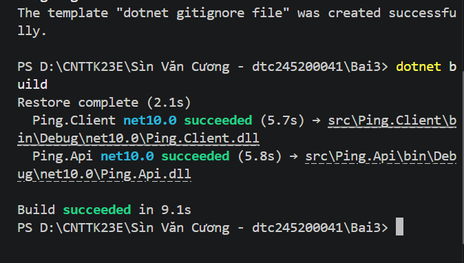
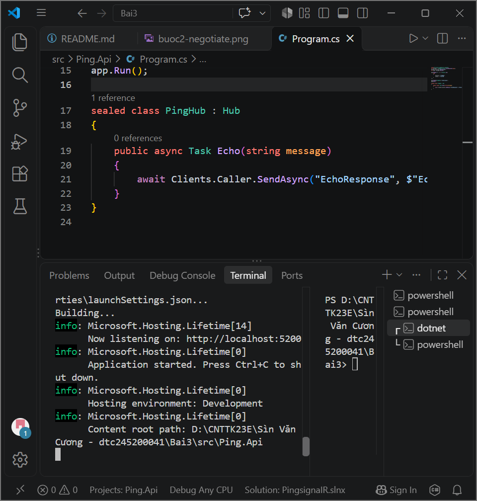
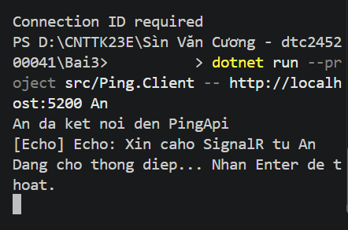

## Bước 1: Hoàn thành tạo dự án

Thấy: Chạy build thành công.
Giải thích: Máy build thành công không lỗi.

## Bước 2: Hoàn thành tạo dự án

Thấy: Máy chủ chạy thành công và truy vấn hiện thông tin.
Giải thích: Máy chủ đã chạy và thông tin hiện đúng theo yêu cầu.

## Bước 3: Hoàn thành thêm code

Thấy: Máy chủ chạy thành công..
Giải thích: Máy chủ đã chạy.

## Bước 4: In [Echo] cho máy khách

Thấy: Chạy bên máy khách và in ra kết quả.
Giải thích: Kết nối An đến PingApi thành công.
